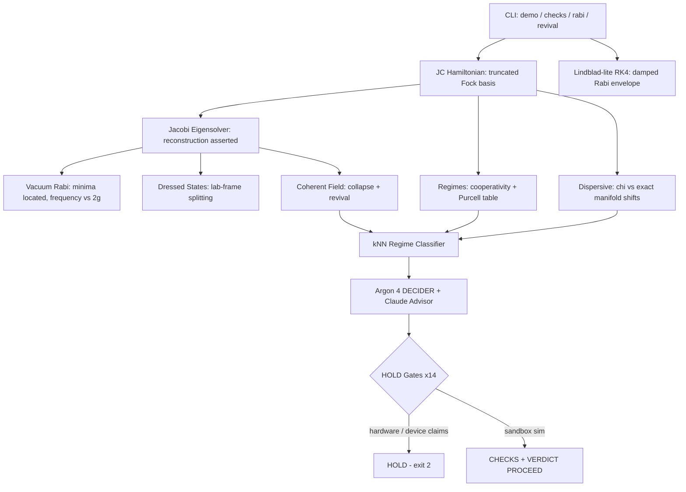
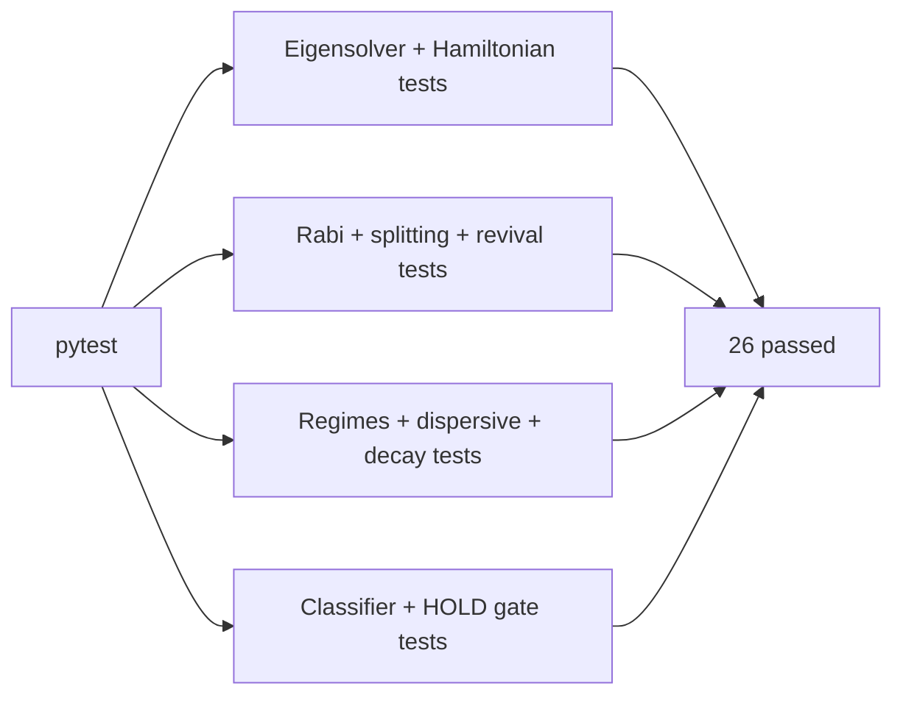
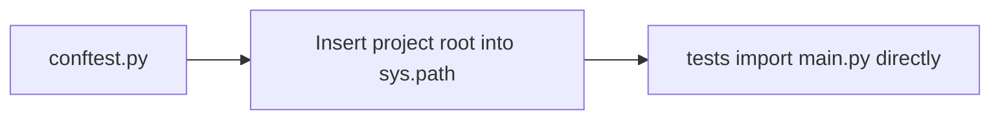
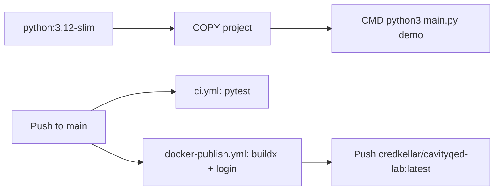

# CavityQED-Lab 🔦⚛️

**Cavity Quantum Electrodynamics Lab** — by Darion Kellar

CavityQED-Lab is an **educational cavity QED lab** in ONE pure-Python file. It builds the **Jaynes-Cummings model** — one two-level atom coupled to one quantised cavity mode — from scratch in a **truncated Fock basis**, diagonalises it with a from-scratch Jacobi eigensolver, and evolves states spectrally, so the famous cavity-QED effects are **measured from the simulation** and graded against the analytic formulas in the open:

- **Vacuum Rabi oscillation** — with the cavity empty, the excited atom and the one-photon state trade the excitation back and forth; the oscillation frequency measured from the simulated P_e(t) is **2.000000**, landing exactly on the analytic **2g**.
- **Collapse and revival** — with a coherent-state field (labelled mean photon number n̄ = 9), each photon-number component oscillates at its own 2g√(n+1); the components dephase into a flat collapse (mean **0.5001**, range **0.0228**) and rephase into a revival measured at **t = 19.4657** against the 2π√n̄/g estimate of 18.8496.
- **Regimes, dispersive physics, dissipation** — cooperativity and Purcell arithmetic on a labelled parameter table, the dispersive cavity pull χ = g²/Δ checked against exact dressed eigenvalues, and a Lindblad-lite cavity decay that damps the Rabi oscillation at the measured envelope rate **0.074997 ≈ κ/2**.

Honest scope, stated up front: every parameter is a **labelled teaching value in dimensionless units** (g = 1 sets the scale) and the basis is a **truncated toy** — no device was measured, calibrated, or controlled, and no number here is a specification of any real cavity, atom, or circuit. Every hardware / sensor / quantum-network claim sits behind a permanent HOLD gate (14 total). 🔒

[](https://github.com/kimanicollier44-cmyk/CavityQED-Lab/actions/workflows/ci.yml)
[](https://github.com/kimanicollier44-cmyk/CavityQED-Lab/actions/workflows/docker-publish.yml)

> ℹ️ These are the **live** workflow badges for this repo. They activate as soon as the `ci.yml` and `docker-publish.yml` files from the paste pack are pasted into `.github/workflows/` — until then they have nothing to report yet.

## 🧰 Tech Stack Badges & Full Architecture Tech Stack

### 💻 Core Programming Languages & Core Systems


- 🐍 Python 3.12, pure standard library (`math`, `hashlib`, `json`, `sys`) — zero dependencies, zero network, deterministic (double-run byte-identical)
- ⚛️ Quantum core: Jaynes-Cummings Hamiltonian in a truncated Fock basis (excitation-number block structure stated in the code), from-scratch cyclic Jacobi eigensolver (reconstruction and orthonormality asserted < 1e-9 in CHECKS), exact spectral evolution written as a real cosine sum — no complex exponentials, no Trotter error
- 🔬 Physics engines: vacuum Rabi + dressed-state splitting, coherent-state collapse/revival, cooperativity + Purcell rate arithmetic, dispersive shifts vs exact manifold eigenvalues, and a 3-state Lindblad-lite RK4 integrator for cavity decay
- 🧠 TinyML kNN regime classifier (from scratch, stdlib): strong-coupling / weak-coupling / dispersive / bad-cavity from (g/κ, g/γ, g/|Δ|)
- 🪑 Council seats: Gemini Argon 4 DECIDER (names-only, tighten-only) + Muse advisor (never overrides HOLD) + Google Flow plan-only (rendered = False, live = 0)

### ⛓️ Web3 & Infrastructure

- 🚫 **Not applicable — honestly.** No blockchain, no Web3, no tokens: the "infrastructure" in this lab is one atom, one cavity mode, and a truncated basis inside one offline file. No fake badges here.

### ⚙️ Platform Support & Hardware Architecture


- 🖥️ Pure Python — runs anywhere Python 3.12+ runs (Linux, macOS, Windows), plus the `python:3.12-slim` Docker image
- 🔒 No hardware is controlled, ever: real cavities, atoms, lasers, and cryogenic plant are permanent HOLD gates (see the gate table below)

### ⚡ Low-Level Infrastructure & Performance

- 🚫 **No low-level code — honestly.** No C, no C++, no GPU, no compiled extensions: this is one interpreted Python file on purpose, so every eigenvalue can be read, checked, and diffed. Performance here means honest algorithms — a cyclic Jacobi solver, a cosine-sum spectral evolution, golden-section peak searches — all deterministic and byte-identical between runs.

### 🛠️ DevOps & Build Tools


- 🐳 Docker (`python:3.12-slim`), GitHub Actions CI + Docker Publish (delivered in the paste pack)
- 🎯 Target image: `credkellar/cavityqed-lab:latest`
- 🧪 Tests: `pytest` (26 tests) + the built-in CHECKS suite (49 checks) in `main.py`

### ☁️ Cloud Providers

- 🚫 **None — honestly.** No cloud provider is used or needed: the lab runs fully offline on your own machine or in a local Docker container. Docker Hub appears only as the registry the publish workflow pushes the image to.

## What this does?

1. 🏗️ **Hamiltonian, built from scratch** — the Jaynes-Cummings Hamiltonian on the basis |atom, n⟩ (atom ∈ {g, e}, photon number n < N_Fock): diagonal energies ±Δ/2 in the rotating frame, couplings g√(n+1) between |e,n⟩ and |g,n+1⟩. Excitation number is conserved, so the matrix is block-diagonal in manifolds — the truncation drops whole manifolds, it never mixes them, and CHECKS assert the zero blocks stay zero.
2. 🧮 **Jacobi eigensolver, from scratch** — cyclic Jacobi rotations diagonalise the real symmetric Hamiltonian; before any physics is trusted, CHECKS assert the reconstruction VΛVᵀ reproduces H and the eigenvectors are orthonormal, both to < 1e-9.
3. 🌊 **Vacuum Rabi oscillation, measured** — starting from |e, 0⟩, the exact spectral evolution gives P_e(t) as a real cosine sum. Golden-section searches locate the first two minima (t = **1.570796**, value 0.0): the measured period is **3.141593 = π/g** and the measured frequency is **2.000000**, exactly the analytic 2g — measured, not quoted.
4. 👗 **Dressed states + vacuum Rabi splitting** — in the lab frame (labelled ω_c = 5), the two eigenvalues nearest the N = 1 doublet centre give the splitting directly: **2.000000 = 2g** on resonance, and **3.605551 = √(Δ² + 4g²)** at Δ = 3 — the avoided crossing, read off the solver's own eigenvalues.
5. 🎞️ **Collapse** — with a coherent field (labelled n̄ = 9, Poisson weights, truncated norm kept to 1 − 2.8e-8), the components dephase: after an early oscillation peaking at **0.9315**, P_e settles to a collapse plateau with mean **0.5001** and a total range of just **0.0228** — flat, and measured flat.
6. 🔁 **Revival** — the components rephase: the highest peak inside [0.7, 1.3] × t_estimate is measured at **t = 19.4657** with height **0.7713**, against the analytic estimate 2π√n̄/g = **18.8496** (relative error 0.0327, printed, not hidden).
7. 🎚️ **Coupling regimes on a labelled table** — cooperativity C = g²/(κγ) across five labelled parameter rows: **1000** at the demo point, extremes **3200** down to **0.1**; strong coupling is the boundary g > κ and g > γ, and the doublet is resolvable when 2g > (κ + γ)/2 — each row prints its own verdicts.
8. 💡 **Purcell enhancement, bad-cavity limit** — the cavity-induced decay Γ_cav = 4g²/κ (valid when κ ≫ g, labelled as such) and the rate-model Purcell factor F_p = Γ_cav/γ = 4C: the bad-cavity row (g = 0.1, κ = 2.0, γ = 0.05) gives Γ_cav = **0.02** and F_p = **0.4** — enhancement below 1, because that cavity leaks too fast to help.
9. 🔀 **Dispersive regime** — at Δ = 10 (g/Δ = 0.1 ≪ 1): χ = g²/Δ = **0.1**, photon-number splitting 2χ = **0.2**, ac Stark shift per photon 2χ. The exact manifold eigenvalues grade the approximation: dressed shifts **0.09902 / 0.196152 / 0.291503** vs the dispersive χ(n+1) = 0.1 / 0.2 / 0.3, an exact per-photon pull of **0.097132**, and the full truncated spectrum matches the manifold union to **8.9e-16**.
10. 💧 **Dissipation, Lindblad-lite** — a 3-state density matrix {|e,0⟩, |g,1⟩, |g,0⟩} with one collapse channel (cavity decay κ = 0.15, labelled) integrated by fixed-step RK4: 12 measured P_e peaks decay from **0.7899** to **0.0590**, the log-linear envelope fit gives **0.074997** against the expected κ/2 = 0.075, the trace is conserved to 3.6e-15, and the κ = 0 control keeps every peak at 1.
11. 🏷️ **Regime classifier + seats + checks** — a from-scratch kNN labels the lab's own parameter sets strong-coupling / dispersive / bad-cavity / weak-coupling from the three regime ratios, with Argon 4 DECIDER (sha256 trace), Muse advisor, Google Flow plan-only, and a built-in CHECKS suite (49 checks).

## 🗺️ How it works — diagram per script

### `main.py` — the whole lab



### `tests/test_main.py` — verification



### `conftest.py` — test path setup



### `Dockerfile` + CI flow — container & publish



## Why is this cool?

1. 🎯 The vacuum Rabi frequency is **measured, then graded**: golden-section searches find the minima of the simulated P_e(t), and the resulting frequency is 2.000000 against the analytic 2g — the simulation passes its own exam in public.
2. 👗 The vacuum Rabi **splitting is read off eigenvalues**, not asserted: the dressed doublet comes out of a from-scratch Jacobi solver whose reconstruction error is itself asserted < 1e-9 before any spectrum is believed.
3. 🎞️ Collapse is **shown flat with numbers**: a plateau mean of 0.5001 with a total range of 0.0228 — dephasing you can measure, not a cartoon.
4. 🔁 The revival is **found, not placed**: the peak is located by search inside a window around the estimate and lands at 19.4657 vs 18.8496 — close, honestly off by 3.3%, and the error is printed.
5. 🎚️ Cooperativity is **arithmetic with the labels on**: five rows spanning C = 0.1 to 3200, each carrying its own strong-coupling and resolved-splitting verdicts.
6. 💡 The Purcell factor is allowed to be **less than 1**: the bad-cavity row's F_p = 0.4 teaches the real lesson — a leaky cavity can hurt emission, not just enhance it.
7. 🔀 Dispersive theory is **graded by its own model**: χ = 0.1 predicted, 0.097132 measured from exact dressed eigenvalues — second-order physics with the correction visible.
8. 💧 The damping rate is **fitted from the simulation**: envelope 0.074997 vs κ/2 = 0.075 — the excitation spends half its life in the lossy mode, and the fit proves the integrator knows it.
9. 🧊 The κ = 0 **control run** keeps every Rabi peak at exactly 1 — the decay you see is the channel you added, not numerical drift (trace conserved to 3.6e-15).
10. 🎯 Deterministic end to end: run it twice, get byte-identical output — a cavity-QED lab you can diff.

## What problems this solves?

1. ❌ **Problem:** Textbook cavity QED quotes 2g, χ, and t_rev as formulas with no way to watch them emerge. ✅ **Solution:** Each one is measured from a from-scratch simulation and printed next to its analytic value with the error showing.
2. ❌ **Problem:** "Strong coupling" gets claimed from a single g value with no loss comparison. ✅ **Solution:** The regime table forces the comparison — g against both κ and γ, plus the resolved-splitting test — on every row.
3. ❌ **Problem:** Collapse and revival are usually shown as one borrowed plot. ✅ **Solution:** The lab computes them from Poisson-weighted spectral evolution and reports the plateau statistics and the revival peak it actually found.
4. ❌ **Problem:** Truncation is the silent sin of every Fock-basis demo. ✅ **Solution:** The cut is a named constant, the truncated Poisson norm (1 − 2.8e-8) is reported, and excitation conservation means the cut drops whole manifolds instead of corrupting them.
5. ❌ **Problem:** The dispersive approximation is often used where it doesn't hold. ✅ **Solution:** The validity ratio g/Δ is printed, and the exact manifold eigenvalues grade the approximation shift by shift.
6. ❌ **Problem:** Purcell enhancement is marketed as always > 1. ✅ **Solution:** The bad-cavity row computes F_p = 0.4 and says why — the rate model is labelled, and the κ ≫ g condition travels with it.
7. ❌ **Problem:** Dissipation demos often leak probability and call it decay. ✅ **Solution:** The Lindblad-lite integrator conserves the trace to 3.6e-15, and the κ = 0 control separates physics from numerics.
8. ❌ **Problem:** Simulated spectra get passed off as device data. ✅ **Solution:** `measured_data_claim` and `publication_grade_spectroscopy_claim` are permanent HOLD gates, and every table is labelled dimensionless teaching values.
9. ❌ **Problem:** Regime classification is usually a vibe ("looks strong-coupled"). ✅ **Solution:** A from-scratch kNN interpolates a stated policy over the three deciding ratios, and the policy itself is printed in the code.
10. ❌ **Problem:** Simulation tools quietly imply a device is next. ✅ **Solution:** 14 named HOLD gates return exit code 2 for every hardware, calibration, network, sensor, or product claim, forever.

## How to install this?

1. 📋 Clone or download this project folder.
2. 🐍 Make sure Python 3.12+ is installed: `python3 --version`
3. ▶️ Run the full demo + checks (no arguments needed):

```bash
python3 main.py
```

4. 🧪 Run the test suite:

```bash
pip install pytest
python3 -m pytest -q
```

5. 🎛️ Try the other commands:

```bash
python3 main.py checks     # 49 built-in checks
python3 main.py rabi       # vacuum Rabi + dressed splitting report (JSON)
python3 main.py revival    # collapse + revival report (JSON)
python3 main.py regimes    # cooperativity + Purcell table (JSON)
python3 main.py dispersive # chi, Stark shifts, exact-vs-dispersive (JSON)
python3 main.py decay      # damped Rabi peaks + envelope fit (JSON)
python3 main.py classify   # kNN regime classifier report
python3 main.py brains     # Argon 4 + Muse + Flow seats
python3 main.py holds      # list all 14 HOLD gates
python3 main.py hold-demo  # exits 2 - gated actions stay HOLD
```

6. 🐳 Or run it in Docker:

```bash
docker build -t credkellar/cavityqed-lab:latest .
docker run --rm credkellar/cavityqed-lab:latest
```

## Requirements

- 🐍 Python 3.12 or newer
- 📦 Dependencies: **none** (standard library only)
- 🌐 Network: **none** — fully offline
- 🧪 For tests only: `pytest`
- 🐳 Optional: Docker

## FULL project structure tree

```text
cavityqed-lab/
├── main.py                  # the whole lab: JC Hamiltonian, Jacobi solver, vacuum Rabi, dressed states, collapse/revival, regimes, dispersive, Lindblad-lite decay, classifier, seats, HOLD gates
├── conftest.py              # puts the project root on sys.path for tests
├── tests/
│   └── test_main.py         # 26 pytest tests: eigensolver, Rabi, revival, regimes, dispersive, decay, gates, determinism
├── assets/
│   └── cover.png            # README cover image (2736 x 912)
├── Dockerfile               # python:3.12-slim, runs the demo
├── .gitignore               # __pycache__/, .pytest_cache/, *.pyc
└── README.md                # this file
```

> 📦 Delivered separately as paste packs (not in this tree): `.github/workflows/ci.yml` + `docker-publish.yml`, and the Docker Hub pack (100-char description, 350-char About, overview, categories).

## 🔒 HOLD gates — all 14, permanent

| # | Gate | What stays held |
|---|------|-----------------|
| 1 | `real_device_calibration_claim` | No calibrating a real cavity, atom, or circuit from labelled teaching values |
| 2 | `hardware_control_claim` | No control of real cavity QED hardware, lasers, or cryogenic plant |
| 3 | `quantum_network_entanglement_claim` | No claiming real remote entanglement distribution from a toy basis |
| 4 | `quantum_communication_security_claim` | No QKD or communication-security claim from this simulation |
| 5 | `sensor_product_claim` | No sensor product claim; a simulated cooperativity is not a sensitivity spec |
| 6 | `fault_tolerance_claim` | No claim this toy model establishes fault-tolerant operation |
| 7 | `quantum_advantage_claim` | No quantum-advantage claim; the whole lab runs classically in stdlib |
| 8 | `medical_imaging_claim` | No medical imaging, sensing, or diagnostic claim |
| 9 | `single_photon_source_product_claim` | No single-photon-source product claim from a truncated basis |
| 10 | `quantum_repeater_product_claim` | No quantum-repeater or network-node product claim |
| 11 | `cryogenic_operation_claim` | No operating or specifying real cryogenic hardware |
| 12 | `measured_data_claim` | Simulated values must never be presented as measured device data |
| 13 | `investment_claim` | No investment claim; a lab model is not a prospectus |
| 14 | `publication_grade_spectroscopy_claim` | Toy spectra must not be presented as publication-grade experimental results |

🧑‍⚖️ **Council seats:** Gemini Argon 4 Extended Thinking — DECIDER (names-only, tighten-only, MAP → MODEL → STRESS → DECIDE, sha256 trace, `can_override_hold = False`) · Muse — advisor (`can_override_hold = False`) · Google Flow — plan-only (`rendered = False`, `live = 0`).

✅ **Verification:** pytest **26 passed** (project + clean copy) · built-in CHECKS **49/49** · double-run output **byte-identical** · `hold-demo` exits **2** · `main.py` **974 lines**, pure stdlib, zero network.

## 🧒 5th-grade English section

Imagine a tiny room with two mirrors facing each other, and one atom standing in the middle. 💡

- The atom can hold one piece of light — a photon — or pass it to the room. In this lab the atom and the room **pass the photon back and forth** like a game of catch, and the lab counts exactly how fast the game goes: the count lands **exactly** on the number the math book promised. 🏓
- Now fill the room with a soft glow made of many photons, all a little different. At first the game of catch is crisp. Then the different photons get **out of step**, like runners on a track spreading out, and the game smears into a blur — that is the **collapse**. Wait longer and the runners come back into step all at once — the game snaps back. That is the **revival**, and the lab times it. 🏃
- If the mirrors are leaky, the photon slips out and the game slowly stops. The lab measures **how fast it fades** and checks the fade matches the size of the leak. 🪞
- If the atom sings a little off-key on purpose, it never trades the photon at all — it just **pushes and pulls** on the glow. The lab measures that push too, and it matches the book's rule for pushing. 🎵
- This project is a **pretend lab on a computer**. It does not build a real mirror room or touch a real atom. It helps you learn how light and atoms talk to each other when they are locked in a tiny room together. 💻

---

MIT © 2026 Darion Kellar · CavityQED-Lab — educational simulation only 🔦
